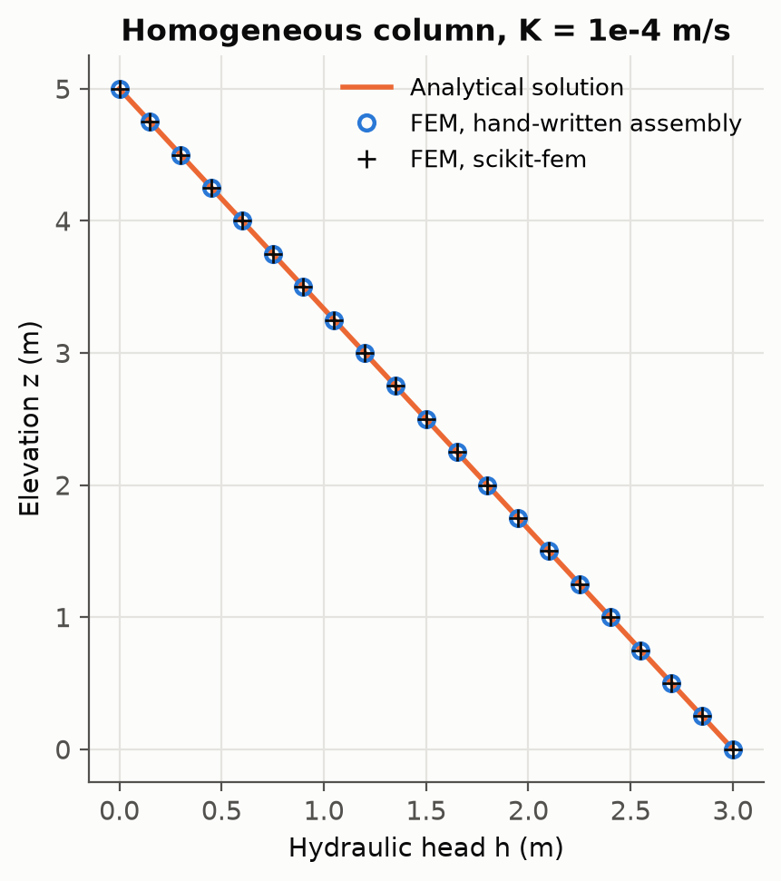
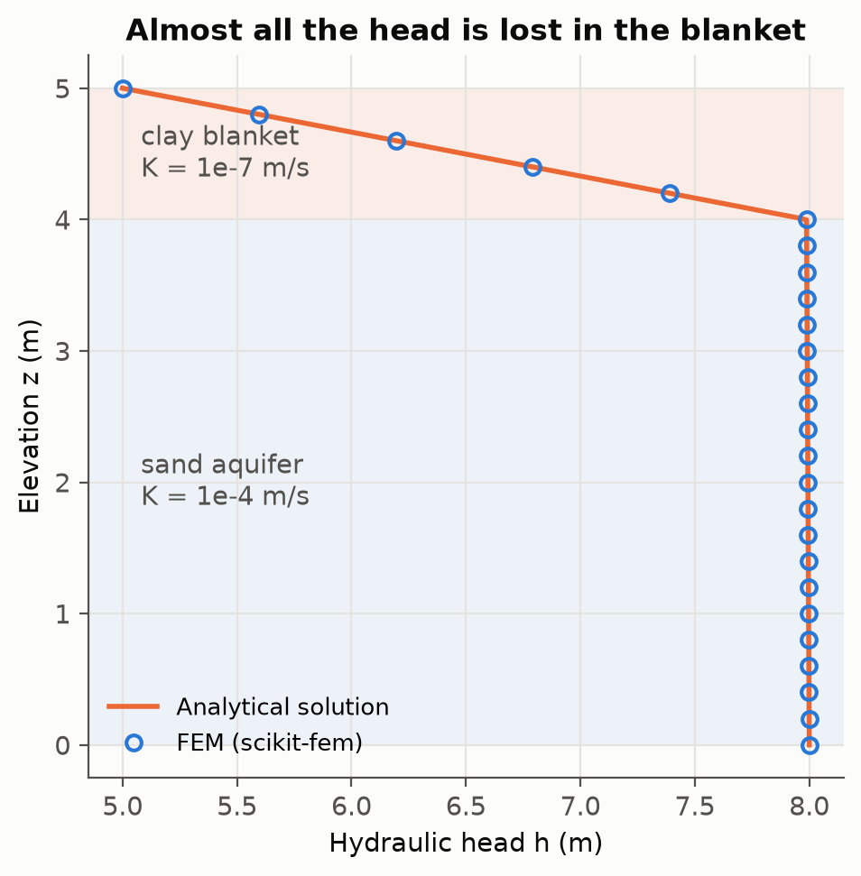
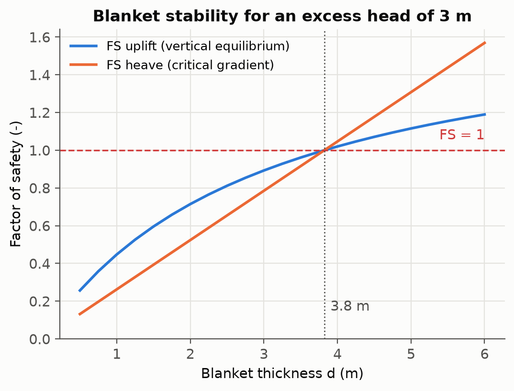
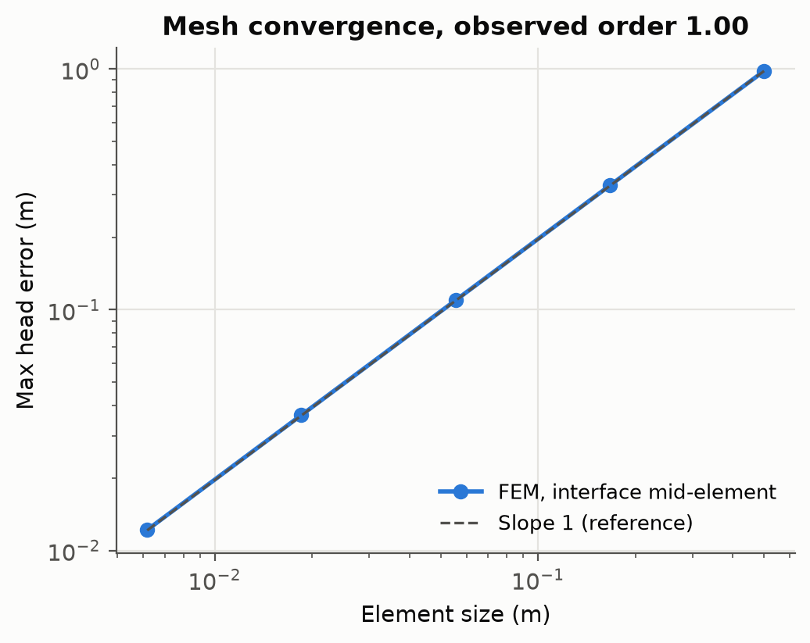
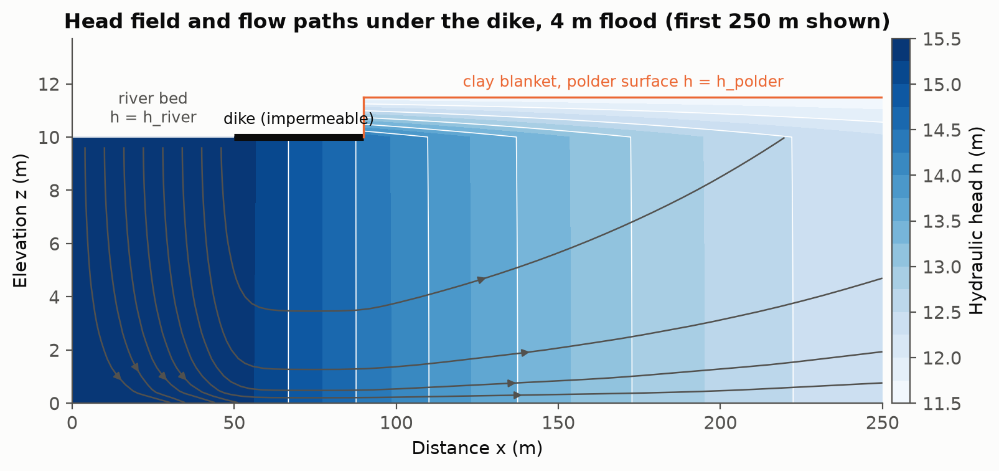
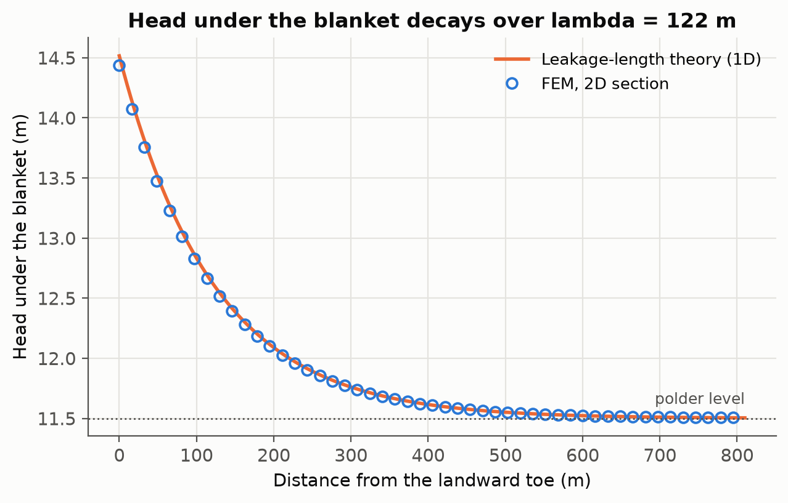
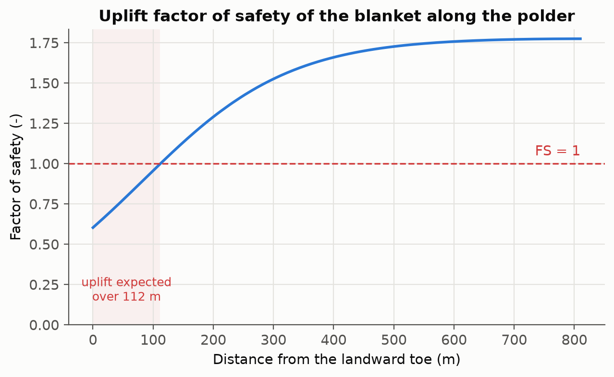

# seepage-fem

**Finite element modelling of groundwater flow under river dikes, from a verified 1D column to a 2D cross-section, as a first step towards backward erosion piping.**

Backward erosion piping starts where seepage under a dike converges at the landward toe: the excess head in the sand aquifer first lifts or cracks the clay blanket (uplift), the exit gradient then mobilises sand (heave), and a pipe grows backwards under the dike. Every one of these stages depends on the head field under the dike, and on how laboratory-scale soil properties carry over to the field.

This repository builds that head field step by step with the finite element method, in Python with [scikit-fem](https://github.com/kinnala/scikit-fem), and checks each step against an independent reference before moving on.

| Script | What it does | Verified against |
|---|---|---|
| `01_column_homogeneous.py` | 1D steady flow, homogeneous column. Solved twice: a hand-written assembly of the 2 × 2 element matrices, and scikit-fem | Exact solution; the two implementations against each other |
| `02_column_blanket_uplift.py` | Sand aquifer under a clay blanket at the landward toe. Uplift and heave factors of safety, blanket-thickness study, mesh convergence | Exact two-layer solution; flux continuity in every element |
| `03_dike_section_2d.py` | 2D vertical section: river bed, impermeable dike footprint, blanket over the polder. Head field, flow paths, head under the blanket, uplift along the polder | Leakage-length (blanket) theory; global mass balance; mesh refinement |

## Governing equation

Steady, saturated, isotropic Darcy flow with no source term:

$$\nabla \cdot \left( K \, \nabla h \right) = 0$$

Weak form solved with piecewise-linear Lagrange elements (P1, Galerkin):

$$\int_\Omega K \, \nabla h \cdot \nabla v \, d\Omega = 0 \qquad \forall v$$

Heads are prescribed on the river bed and the polder surface. Every other boundary (aquifer base, lateral boundaries, dike footprint) is no-flow, which the weak form imposes naturally. Each nodal equation of the assembled system is a discrete mass balance: what enters a node leaves it.

## Results

### 1. Homogeneous column: the method is exact at the nodes

Both implementations reproduce the linear solution to machine precision (max error 2.7 × 10⁻¹⁵ m), and differ from each other by 4 × 10⁻¹⁶ m. The 3-element example prints the global matrix, `[[1,-1,0,0],[-1,2,-1,0],[0,-1,2,-1],[0,0,-1,1]]`, that can be checked by hand.



### 2. Blanket over an aquifer: almost all the head is lost in the clay

4 m of sand (K = 10⁻⁴ m/s) under 1 m of clay (K = 10⁻⁷ m/s), with an excess head of 3 m in the aquifer.

- Matches the exact two-layer solution to 10⁻¹³ m; the Darcy flux is identical in all 50 elements (relative spread 5 × 10⁻¹¹).
- **99.6 % of the head is lost in the blanket**: the vertical gradient across it is 3.0, against a critical gradient of 0.78.
- Pore pressure under the blanket 39.1 kPa against a blanket weight of 17.5 kPa: **FS uplift = 0.45**, FS heave = 0.26. The blanket would lift: this is the first stage of piping.
- A blanket of **3.8 m** would be needed to reach FS = 1 under a 3 m excess head.




**Mesh must follow the layers.** With the sand-clay interface placed in the middle of an element, the error converges at first order (observed order 1.00). With a node on the interface, the error drops back to machine precision. In 2D and 3D, this is why the mesh is aligned with, and refined at, the blanket-aquifer interface.



### 3. 2D cross-section under a dike

Aquifer 10 m thick, blanket 1.5 m over the polder, seepage length 40 m from the river bed to the landward toe, flood level 4 m above the polder. 7 287 nodes, 13 940 triangles, solved in about one second.



- **Mass balance**: inflow from the river bed and outflow through the blanket agree to 4 × 10⁻¹⁰ (relative), computed from the nodal reactions.
- **Comparison with the leakage-length theory** used in Dutch dike assessment (λ = √(K_a D d / K_b) = 122 m): the head under the blanket at the toe is 14.44 m with the FEM against 14.52 m with the 1D theory, and the two curves differ by at most 1.9 % of the head difference along the whole polder. The theory assumes horizontal flow in the aquifer and vertical flow in the blanket; the 2D model does not, which accounts for the small difference near the dike.
- **Mesh refinement**: doubling the resolution in both directions changes the head at the toe by 3 mm.
- **Uplift**: FS = 0.60 at the toe, below 1 over the first 112 m of the polder. This is where sand boils would be expected.




## Run it

```bash
python -m venv .venv
source .venv/bin/activate          # Windows: .venv\Scripts\activate
pip install -r requirements.txt
python 01_column_homogeneous.py
python 02_column_blanket_uplift.py
python 03_dike_section_2d.py
```

Each script prints its checks to the terminal and writes its figures to `figures/`. Total run time is a few seconds.

## Assumptions and limits

- Steady state, fully saturated, isotropic layers with uniform conductivity. A sandy aquifer responds to a flood in minutes to hours, so steady state is a reasonable and conservative first approximation for a flood lasting days; it is less so under thick or compressible blankets.
- No erosion yet: the model gives the hydraulic loading that drives piping (exit gradient, uplift), not pipe growth.
- The landward toe is a geometric singularity (the no-flow dike footprint meets the blanket). Heads converge there (3 mm change on refinement); point gradients at the corner do not, so gradients are evaluated over the blanket thickness rather than at the corner.
- Parameter values are illustrative, not site-specific.

## Next steps

1. **Pipe progression.** Add a pipe as a high-conductivity line element at the top of the aquifer and grow it with a critical-gradient criterion, to compare against Sellmeijer's rule and laboratory-scale experiments.
2. **Heterogeneity at the interface.** Replace the uniform aquifer with layered and stochastic conductivity fields, including coarse-over-fine contrasts derived from fluvial architecture, and quantify how the exit gradient and the critical head change.
3. **From laboratory to field.** Use the same code at laboratory scale (small-scale piping set-ups) and field scale, to study how parameters calibrated on a sample transfer to a dike, and where pore-scale structure, imaged by X-ray micro-CT, enters that chain.
4. **Coupling.** Hydro-mechanical coupling of the blanket (effective stress, deformation) and a radial version of the same problem for sand production around a well screen.

## Author

Intchi Amadou Roufai Abdoul Latif · MSc Biogeosciences, University of Neuchâtel
